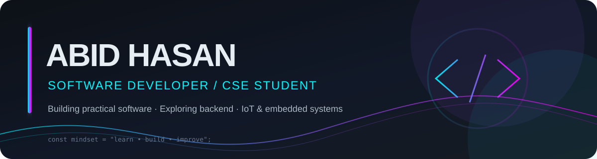
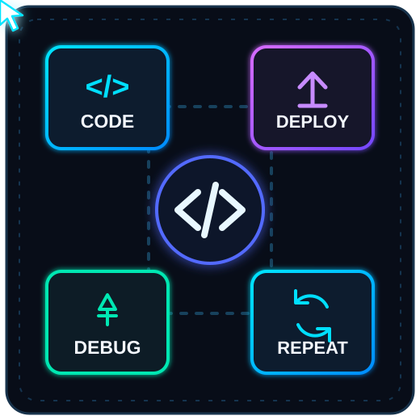
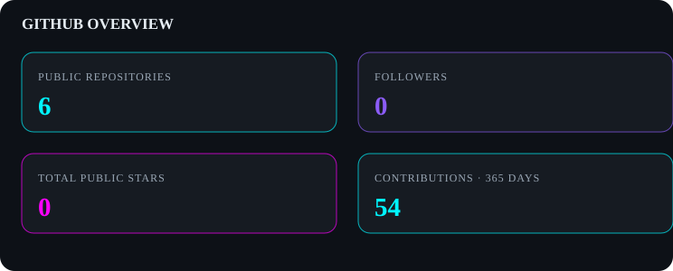
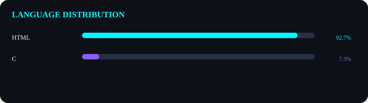
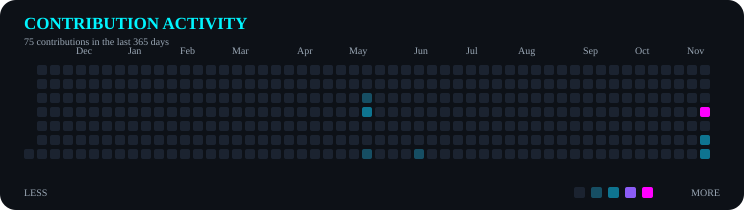

  

---

## About Me

I'm a Computer Science & Engineering student at **Daffodil International University** interested in building practical software and technology solutions. I enjoy learning by creating projects, exploring how systems work, and improving my problem-solving skills.

- 🎓 B.Sc. in Computer Science & Engineering — Daffodil International University
- 💻 Interested in software, web, and backend development
- 🧠 Strengthening my foundation in Data Structures and Algorithms
- 🔌 Exploring IoT and embedded systems
- 🏆 **Best Performer — IoT Lab**

  

## Technology Stack

| Category | Technologies |
|---|---|
| Programming | C, C++, Python |
| Web | HTML, CSS, JavaScript |
| Backend & Services | Node.js, Firebase |
| Hardware & IoT | Arduino |
| Developer Tools | Git, GitHub, VS Code |

## Featured Projects

<table>
  <tr>
    <td width="50%">
      <h3><a href="https://github.com/abidhasan789diu-ship-it/code789">Code789</a></h3>
      
A browser-based code storage/snippet project. The repository description mentions Firebase-backed storage and a unique ID/password system.

      
HTML · CSS · JavaScript · Firebase (as described by the repository)

    </td>
    <td width="50%">
      <h3><a href="https://github.com/abidhasan789diu-ship-it/Bus-Reservation-System-Code">Bus Reservation System</a></h3>
      
A C project with admin and user panels, bus and seat management, booking, and ticket cancellation rules.

      
C · Structures · Arrays · Time

    </td>
  </tr>
</table>

## GitHub Analytics

  

## Programming Language Distribution

  

## Contribution Activity

  

## Achievements

- 🏆 Best Performer — IoT Lab

## Current Focus

- Strengthening Data Structures and Algorithms
- Improving C, C++, and Python programming
- Building web and backend development skills
- Exploring practical IoT and embedded projects

## Learning Journey

| Area | Focus |
|---|---|
| Programming | C, C++, Python |
| Web Development | HTML, CSS, JavaScript |
| Backend | Node.js, Firebase |
| Computer Science | Data Structures & Algorithms |
| Hardware | Arduino, IoT |
| Tools | Git, GitHub, VS Code |

## Connect

- GitHub: [@abidhasan789diu-ship-it](https://github.com/abidhasan789diu-ship-it)

---

*Learning continuously. Building thoughtfully.*

